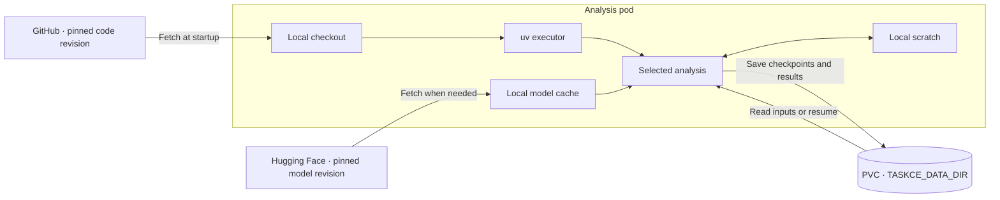

# TaskCE

TaskCE studies how fine-tuning changes the internal representations of language models. It compares a base model with task-specific LoRA variants by capturing neuron activations, fitting Boolean compositional formulas, and measuring which internal features stay stable, change behavior, or recur across layers.

## Repository layout

Eight independent top-level folders own the analytical methods, and `taskce/` owns the shared CLI executor, study profiles, and data-root resolution:

- [`capture/`](capture/) records final-token activation matrices for base and PEFT LoRA checkpoints.
- [`activation_analysis/`](activation_analysis/) measures threshold coverage, neuron fate, and PCA task separation over saved captures.
- [`formula_search/`](formula_search/) builds binary lexical features and fits Boolean formulas with GPU beam search, including the pinned `vectorized_search` 2.a Triton backend.
- [`formula_comparison/`](formula_comparison/) computes tree-edit formula diffs, heatmaps, and standalone HTML AST viewers from formula CSVs.
- [`joint_search/`](joint_search/) compares symbolic conjunctions of parent neuron formulas against formulas searched directly on measured joint firing.
- [`cross_layer_recurrence/`](cross_layer_recurrence/) indexes recurring compound subformulas across layers, extracts nested multi-stage chains, and matches compounds to earlier single neurons.
- [`graph_analysis/`](graph_analysis/) builds Pearson correlation and cosine similarity neuron graphs, detects communities, and attaches compositional formulas.
- [`ablation/`](ablation/) ranks explained neurons and measures task accuracy deltas under zero-ablation forward hooks.

Standalone task evaluation lives outside TaskCE. Formula-fit IoU remains inside `formula_search/` and `joint_search/`, and `ablation/` retains the single-token logit hook inference required to measure interventions.

## Pod data paths and `TASKCE_DATA_DIR`



Code, model caches, and durable research data stay on separate paths:

- **Code and Python environment.** Keep the git checkout and `.venv` in the container image or on pod-local storage so Python imports avoid network-volume latency.
- **Durable data (`TASKCE_DATA_DIR`).** Every analysis resolves captures, prepared `.npz` bundles, trained tokenizers, checkpoints, and per-run outputs under `TASKCE_DATA_DIR`. When `TASKCE_DATA_DIR` is unset locally, it defaults to `./data`. On a pod, point `TASKCE_DATA_DIR` at the mounted PVC directory.
- **Frozen baselines (`TASKCE_BASELINE_DIR`).** Read-only reference archives default to `<TASKCE_DATA_DIR>/../baselines/57a1e74` when present or can be set explicitly through `TASKCE_BASELINE_DIR` or `--baseline-dir`.
- **On-demand model cache (`HF_HOME`).** Stages that do not load weights (`joint-search`, `cross-layer-recurrence`, `formula-comparison`, `graph-analysis`, `activation-analysis`, and `ablation --stage select`) never import `transformers`, `peft`, or `huggingface_hub` and never trigger model downloads. When a stage requires a model or dataset, `taskce/hf.py` keeps `HF_HOME` on pod-local storage outside `TASKCE_DATA_DIR`.

## Setup

Full dependency installation requires Linux x86_64 with an NVIDIA GPU and CUDA 12.8 driver because `pyproject.toml` pins a Linux FlashAttention wheel and NVIDIA cuGraph.

Install [mise](https://mise.jdx.dev/getting-started.html) or `uv`, then sync the environment on pod-local disk:

```sh
uv sync --python 3.12
```

Verify the environment, pinned SHA-256 hashes, and mounted data paths without downloading models:

```sh
export TASKCE_DATA_DIR="/~ /TaskCE/data"
uv run taskce list
uv run taskce doctor --profile snli
```

## Run analyses with the executor

Every analysis runs through `uv run taskce <analysis> --profile <profile>`. Each fresh run writes into an isolated `<TASKCE_DATA_DIR>/runs/<analysis>/<profile>/<run_id>/` directory with atomic checkpoints and per-stage wall-clock timing in `run_meta.json`.

### Reproduce the SNLI joint-search baseline

On a GPU pod with the `ggong1-dev-main` PVC mounted at `/~ /`:

```sh
export TASKCE_DATA_DIR="/~ /TaskCE/data"
uv run taskce joint-search --profile snli --check-only
uv run taskce joint-search --profile snli --verify-baseline
```

The `validate` stage checks the SHA-256 digests of `features.npz`, `layer.8.npz`, `layer.8.csv`, `layer.8.csv.manifest.json`, `formula_eval.py`, and the three `vectorized_search` modules before running any GPU kernel. The `sweep` stage executes all 24 `(pair, length)` search cells, writes `sweep.csv` and `results.json`, and `--verify-baseline` compares `baselines.json`, `masks.npz`, `sweep.csv`, and all 24 cell files against `TaskCE/baselines/57a1e74` in `reproduction_report.json`.

To resume an interrupted run directory after preemption, pass `--run-id <run_id> --resume`.

### Run cross-layer recurrence without model downloads

```sh
export TASKCE_DATA_DIR="/~ /TaskCE/data"
uv run taskce cross-layer-recurrence --profile snli
```

By default this runs the CPU-only `index`, `chains`, and `match` stages over saved formula CSVs and prepared `.npz` features. Pass `--stage full_sweep` on a GPU pod to refit all configured layers first.

### Run capture, formula search, comparison, graphs, and ablation

```sh
export TASKCE_DATA_DIR="/~ /TaskCE/data"
export HF_HOME="/tmp/hf-cache"

uv run taskce capture --profile snli --batch-size 32
uv run taskce activation-analysis --profile snli --layer model.layers.8.feed_forward
uv run taskce formula-search --profile snli --layer layer.8
uv run taskce formula-comparison --profile snli --stage ast_viewer --csv path/to/layer.8.csv
uv run taskce graph-analysis --profile snli --formula-path path/to/snli_beam_results.csv
uv run taskce ablation --profile snli --formula-path path/to/snli_beam_results.csv
```

### Search the LLM's final embedding normalization with attention

`neural_search` fits the final-token coordinates of `model.embedding_norm` one at a time. Run it against the same prepared SNLI features and activation capture used by the symbolic backends.

```sh
uv run taskce formula-search --profile snli --backend neural_search --layer embedding_norm --ids 0,1,2,3,4,5 --all-examples --chunk-size 1 --device cuda
```

The run directory contains `embedding_norm.csv`. With `--all-examples`, its `fit_iou` column reports the overlap across all 10,000 examples for each neuron. Follow the `attention_path` column to the concept weights and cutoff that reproduce its firing mask. See the [neural search method and replay example](formula_search/neural_search/README.md).

### Add a new study profile

Built-in TOML profiles live in [`taskce/profiles/`](taskce/profiles/) (`snli`, `claim`, `fallacy`). To add a new study such as `bowman`, place `bowman.toml` in `$TASKCE_DATA_DIR/profiles/bowman.toml` or pass `--profile ./bowman.toml`. Profiles support single-level inheritance with `extends`:

```toml
name = "bowman"
description = "Bowman CoEx single-neuron and joint-search study"
extends = "snli"

[model]
lora_task = "bowman"

[dataset]
name = "bowman"
hf_id = "stanfordnlp/snli"
split = "validation"
tokenizer_name = "spacy-pos-bowman-features"

[artifacts]
prepared_inputs_relpaths = ["bowman/inputs"]
```

Newly trained feature tokenizers save to `$TASKCE_DATA_DIR/tokenizers/` so the repository checkout stays clean.

## Frozen Nautilus baseline

The frozen reference dataset from commit `57a1e74` lives on the Nautilus PVC `ggong1-dev-main` under `TaskCE/baselines/57a1e74/` and is indexed by [`taskce/resources/baseline_57a1e74.json`](taskce/resources/baseline_57a1e74.json). See [`formula_comparison/formula_ast/README.md`](formula_comparison/formula_ast/README.md) to build and verify offline HTML AST viewers.
