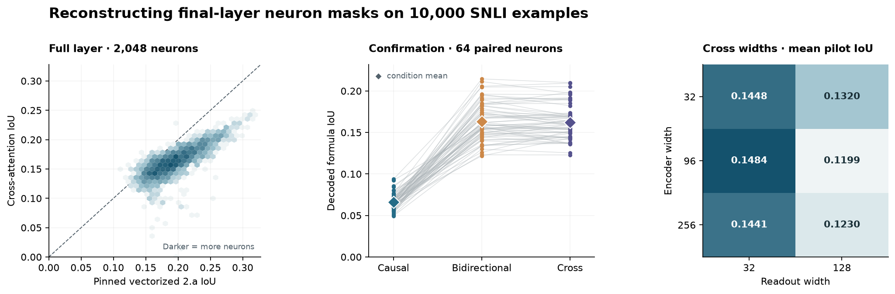

# Generating Boolean formulas from attention on the SNLI LLM

Across all 2,048 final embedding-normalization neurons, cross-attention reached **0.1626 mean IoU**. Pinned vectorized search 2.a reached **0.1951**. The learned formulas beat 2.a on 105 neurons and lost on 1,943. All 105 wins required more than 48 terms.

| Full-layer result | Mean IoU | Median IoU | Median terms | Median warm seconds |
| --- | ---: | ---: | ---: | ---: |
| Pinned vectorized 2.a, beam 40 | **0.1951** | 0.1903 | 48 | 7.59 |
| Cross-attention 96/32, first 48 terms | 0.1288 | 0.1223 | 48 | Same fitted model |
| Cross-attention 96/32, complete formula | 0.1626 | 0.1621 | 99 | 5.76 |

The neural formulas contained 1–518 distinct concepts. Of the 1,855 formulas longer than 48, continuing raised IoU on 1,849 and lowered it on six. Mean IoU gained **0.0338** across the full layer. Pinned 2.a always used 48 occurrences and sometimes reused an ID. Its distinct-concept count ranged from 42 to 48. Among the 2,032 neurons outside the size pilot, mean IoU was 0.1627 for cross-attention and 0.1952 for 2.a.

The operator readout rarely used its full vocabulary. On 2,029 neurons it produced no AND or AND NOT joins. Replaying all selected concepts as OR gave 0.1623 mean IoU, close to the learned formulas' 0.1626. Sorting those same concepts by inclusion score in place of their learned order changed IoU on just 15 neurons. These checks explain why rearranging the many selected concepts had little effect on most formulas.

## Does following the attention path help?

On the same 16 neurons, bidirectional self-attention beat causal self-attention on all 16. It beat cross-attention on eight and pinned vectorized 2.a on one. Each self-attention model used a 96-dimensional encoder and a 32-unit operator readout.

| Decoder and concept order | Mean IoU | Median concepts kept | Median concepts visited | Median warm time per neuron |
| --- | ---: | ---: | ---: | ---: |
| Cross-attention, learned order score | 0.1484 | 90.5 | 90.5 | 4.88 s |
| Bidirectional self-attention, original vocabulary | 0.1454 | 85 | 85 | 13.02 s |
| Causal self-attention, original vocabulary | 0.0676 | 324.5 | 5.5 | 6.78 s |
| Causal self-attention, shuffled vocabulary | 0.0605 | 364.5 | 7.5 | 7.36 s |
| Pinned vectorized 2.a | 0.1830 | — | 48 | 6.07 s |

The self-attention window ends with the neuron, preceded by all 3,854 concept tokens. The model emits four numbers for each concept. Its neuron-to-concept attention logit plus a learned bias determines whether to keep it. The other three scores come from a shared readout of each concept's contextualized representation and choose OR, AND, or AND NOT. Starting from the neuron, the decoder follows the strongest attention edge to an unvisited, kept concept. Its next hop uses **that concept's own attention row**. The first visit creates an atom and each subsequent visit applies its predicted operator to the running formula. The saved four-column table and Q/K factors reproduce the result.

For neuron 0 in the original causal layout, the path followed vocabulary IDs `1973 → 23 → 21 → 8`. This produced `hypothesis:people OR premise:outside OR premise:women OR premise:men`. At the second hop, the neuron's highest remaining legal edge would have chosen `premise:bottle`. The attention row of `hypothesis:people` chose `premise:outside`. Those four masks intersected 177 of the neuron's 543 positive examples. The formula fired on 2,132 examples, giving IoU 0.0709. The model had kept 373 concepts. After reaching position 8, it had no kept, unvisited concept to its left.

Every causal path ended with stranded concepts. Across the 16 neurons, original causal paths visited 1.60% of all kept concepts. Shuffling the vocabulary with seed 1729 changed all 16 formulas and increased coverage to 2.05%. Bidirectional paths visited 100%, because every remaining kept concept was reachable from every step. A control retrained bidirectional neuron 0 with that same shuffle. All four output columns, Q/K factors indexed by original ID, and the entire path matched bit for bit. These variants used no positional embeddings.

The bidirectional walk changed the visitation order on all 16 neurons compared with sorting the **same visited IDs** by their neuron-to-concept scores. The final IoU changed on five neurons, increased on three, and averaged 0.1454 for the path versus 0.1442 for the score-sorted order. The readout chose 1,423 OR, 113 AND NOT, and zero AND joins. Changing the order of a chain of OR operations leaves its mask identical. On these runs, the causal restriction had a much larger effect than the choice of ordering among the bidirectional model's selected concepts. The [path-pilot CSV](attention_path_pilot.csv) contains the actual formulas, both orderings' scores, and gate and visit counts.

### Confirmation on 64 additional neurons

Because cross-attention and bidirectional attention split the pilot eight wins each, a second run drew 64 neurons uniformly without replacement from the 2,032 outside the tuning panel (seed 24112026). Both native-layout path models used the same 96/32 widths, 256 updates and 10,000 examples. Cross-attention and 2.a scores come from the corresponding full-layer rows.

| Method | Mean IoU | Median kept | Median terms visited | Median warm time |
| --- | ---: | ---: | ---: | ---: |
| Bidirectional self-attention | 0.1633 | 99.5 | 99.5 | 18.98 s |
| Cross-attention | 0.1623 | 95 | 95 | 5.89 s |
| Causal self-attention | 0.0661 | 384 | 6 | 9.02 s |
| Pinned vectorized 2.a | 0.1936 | — | 48 | 7.18 s |

Bidirectional paths beat causal paths on all 64 neurons. They beat cross-attention on 33 of 64 and 2.a on three. Their mean advantage over cross-attention was 0.00094 IoU. A paired bootstrap over these neuron IDs gave a 95% interval from −0.00148 to +0.00335 (20,000 resamples, fixed seed). This comparison leaves the small quality difference between cross-attention and bidirectional attention unresolved. Bidirectional decoding and fitting took more time in these implementations.

Causal walks visited 1.71% of the kept concepts, pooled across the cohort. Bidirectional walks visited 100%. Reordering the same visited IDs by their original neuron score changed bidirectional IoU on nine neurons. That replacement averaged 0.1628, compared with 0.1633 for the actual path. Each per-neuron formula, timer, matched score and ablation is in the [confirmation CSV](attention_path_confirmation.csv).

## What changing the model size did

Each cell shows mean terminal IoU on the same 16 preselected neurons, with median warm seconds per neuron in parentheses. Every fit used 256 updates. The widths in each column refer to the hidden layer that reads out the order and operator scores.

| Q/K/V encoder width | Readout width 32 | Readout width 128 |
| ---: | ---: | ---: |
| 32 | 0.1448 (4.76 s) | 0.1320 (4.83 s) |
| 96 | **0.1484 (4.88 s)** | 0.1199 (4.81 s) |
| 256 | 0.1441 (5.37 s) | 0.1230 (5.64 s) |

The 96/32 model has 2,889,382 trainable parameters. Moving from 32 to 96 helped at readout width 32. Moving to 256 surrendered that gain. The wider readout scored lower at each encoder width under this update budget. Selection used the highest mean terminal IoU and median warm time as the tiebreaker. The full-layer run used the winning widths for every neuron. The [width-pilot CSV](attention_width_pilot.csv) includes all 96 fits.

## What actually trains the transformer

One input token is a neuron's binary firing mask. Every other token is an original named concept's binary presence mask across the same 10,000 examples. Each fit starts from fresh weights and a fresh Adam optimizer. All 256 updates see the same neuron and all concept tokens. During each update the policy samples 24 complete formulas. Their terminal IoUs on the original masks supply the policy-gradient reward. The mean reward of the other 23 draws provides a baseline for each draw. Gradients reach the Q, K and V projections and the shared readout through the probabilities of the sampled decisions.

At inference, the cross-attention model emits one row of five logits per concept. The raw scaled Q/K score plus a learned bias supplies the keep logit. An MLP reads the query, the concept key and the attention-weighted value summary to produce an order score and three operator logits. A nonnegative keep logit includes the ID, descending order score determines its position, and the highest operator logit chooses its join. Each included ID can occur once. Self-attention uses the same keep rule and replaces the order score with the attention walk. Both decode a single formula directly from the final model. IoU evaluation then measures its mask.

An offline check tried changing one operator at a time while holding every selected ID and its position fixed. On the matched pilot, every cross-attention and bidirectional formula had some improving edit. Even the best single edit added only 0.0011 mean IoU for cross-attention and 0.0025 for bidirectional self-attention. This test measures headroom for one edit. It leaves open the effects of selecting different concepts or changing several operators together.

## Repeated updates and a held-out check

For fixed neurons 0–5, the winning cross-attention configuration averaged 0.0000 in-sample IoU with fresh weights, 0.0746 after 48 updates and 0.1442 after 256. Each update reused the same concepts and examples for the same neuron.

In a separate six-neuron check, 6,001 examples set the firing thresholds and fitted the formulas. Each resulting formula was then applied unchanged to the premise-grouped validation and test examples.

| Method | Fit IoU (6,001 examples) | Validation IoU (1,917) | Test IoU (2,082) |
| --- | ---: | ---: | ---: |
| Cross-attention 96/32 | 0.1776 | 0.0642 | 0.0723 |
| Pinned vectorized 2.a | 0.2258 | 0.0420 | 0.0668 |

The split involved six neurons. The full-layer and attention-path comparisons measure reconstruction on all 10,000 search examples.

## Inputs, timing and reproduction

The activation capture comes from the final token at `model.embedding_norm` in `LiquidAI/LFM2.5-1.2B-Thinking`, SNLI LoRA checkpoint 882. A target fires where its activation strictly exceeds the neuron's 94.5th percentile. The primary comparisons train and score on all 10,000 examples. All 2,048 targets qualify for the full run, including the 69 below the CLI's default 500-positive cutoff. The vocabulary has 1,971 premise concepts and 1,883 hypothesis concepts. Both searches used the same frozen files and targets. Example order follows the capture pipeline. The saved activations have no independent row IDs for a second join.

The pilot IDs were 0, 1, 2, 3, 4, 5, 127, 255, 383, 511, 639, 767, 895, 1023, 1279 and 1535. Using one model seed (20261111) isolates the specified configuration comparisons. The pilot establishes a ranking for these neurons, this initialization and this training budget.

Nautilus Kubernetes ran PyTorch 2.6.0 with CUDA 12.4 on NVIDIA TITAN Xp cards. Each worker fitted one neuron at a time, synchronizing CUDA around model construction, transfers, fitting and final decoding. Reading the frozen inputs, independently checking the formula and writing artifacts occurred outside the timed interval. Warm medians exclude the first fit per worker. The vectorized 2.a times come from a separate run on the same hardware class. Its archived formulas were replayed against the current masks for all 2,048 neurons.

## Artifacts and replay

The [full-layer CSV](attention_layer_metrics.csv) contains paired scores, counts, operator totals, timings, prefix-48 scores and table checksums. The [compressed formula archive](attention_layer_formulas.jsonl.gz) begins with the ordered vocabulary and then stores the complete formula, ordered IDs, operators and prefix scores for each neuron. Re-decoding every five-column table and replaying each formula against the original masks reproduced every reported intersection and IoU. All 16 repeated width-pilot tables matched their full-layer counterparts bit for bit.

The cross-attention and self-attention benchmarks ran from [revision 802e030](https://github.com/aiea-lab/TaskCE/commit/802e0301e621e83f75ecb117deafe1c5e67777e2). A real-input CLI check found that example subsetting changed the memory strides of the self-attention inputs. This changed floating-point reductions and the resulting sampled training trajectory. [Revision 6b80817](https://github.com/aiea-lab/TaskCE/commit/6b80817) makes the token tensor contiguous before those reductions. The captured benchmark inputs were already contiguous. The ordinary search CLI reproduced all six checked cross-attention tables and both path modes' neuron-0 tables, formulas and IoUs bit for bit on the Titan Xp.

The complete replay package is stored on the Nautilus claim `gilpin-lab/ggong1-dev-main` at `TaskCE/data/runs/neural-search/attention-802e030`. It includes the inputs, every five-column output table, self-attention tables and edge factors, worker metadata, frozen sources, Kubernetes job records, and verification scripts. For a new search, see the [CLI commands and table schema](README.md).
