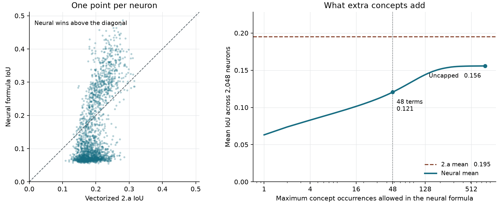

# Historical comparison of greedy formula search and vectorized 2.a

These results describe the retired greedy action scorer. The current neural search generates a complete formula using a learned order score or a self-attention path. See the [model and decoder](README.md).

On all 2,048 final embedding-normalization neurons of the SNLI LLM, pinned 2.a reached mean IoU **0.1951**. The 256-update neural formula search reached **0.1558** with unrestricted decoding and **0.1206** at 48 concept occurrences. The unrestricted search won on 659 neurons, tied on 0, and lost on 1,389. Every comparison used the same 10,000 examples on a Titan Xp.

| Configuration | Mean IoU | Median IoU | Median concept occurrences | Median search time per neuron |
| --- | ---: | ---: | ---: | ---: |
| Vectorized 2.a, beam 40, limit 48 | 0.1951 | 0.1903 | 48 | 7.59 s |
| Neural formula, first 48 occurrences | 0.1206 | 0.0893 | 48 | Same fit, prefix replay |
| Neural formula, unrestricted | 0.1558 | 0.0975 | 75 | 1.25 s |



## What longer formulas bought

Every 2.a result used 48 concept occurrences. The neural formulas ranged from 2 to 773 occurrences. The middle half ran from roughly 44 to 129 occurrences. 1,455 of 2,048 (71.0%) exceeded 48 occurrences, and 1,453 used more than 48 **distinct** concepts. Repeated names count once per occurrence toward either method's length.

Going past 48 added **0.0352 mean IoU** across the layer, or 0.0495 averaged over the longer formulas. At 48, the neural policy beat 2.a on 5 neurons. Additional concepts turned a loss into a win on 654 more. Training and the learned proposal order were identical for both length measurements. We replayed the prefix at 48 and at each paired 2.a formula's actual length. At that matched length the neural mean was 0.1206.

The largest neural advantage was neuron 451 (neural 0.4288, 2.a 0.1807, 537 neural occurrences). The largest 2.a advantage was neuron 959 (neural 0.0744, 2.a 0.2848, 17 neural occurrences).

## What selected a concept

The context contained one neuron firing mask and all 3,854 named binary concept masks. A fresh policy and Adam optimizer saw those same 10,000 examples for 256 updates per neuron. Each action logit combined target-to-concept attention with learned features of the candidate formula's true and false positive counts. The training objective used the exact candidate IoUs to reward good actions. During decoding, the policy ranked concept/operator pairs and accepted the first of its 16 highest-ranked proposals that strictly increased the current formula's IoU. Formula length could grow until the policy stopped finding improvements.

On neuron 0 the policy began with `hypothesis:people`, then added `OR hypothesis:woman` and `OR premise:men`. The 48-term prefix scored 0.0993. The final 73-term formula scored 0.1106. Across the layer the decoder selected 118,415 OR, 0 AND and 75,797 AND NOT actions after the initial atoms. Exact planted-formula tests exercise each operator.

An independent check tried every possible one-step extension of each final neural formula. **2,048 of 2,048** still had an improving move. The median final formula had 2,195 such moves. Appending the best one would have added 0.0051 mean IoU. This diagnostic measures how often the model's proposal ranking stopped progress. The reported search scores use the model's own accepted formula.

## Data and timing

The capture is the SNLI checkpoint 882 adapter for `LiquidAI/LFM2.5-1.2B-Thinking`, measured at the final token of `model.embedding_norm`. The vocabulary contains 1,971 premise concepts and 1,883 hypothesis concepts. A neuron fired wherever its activation strictly exceeded its 94.5th percentile on the search examples. Supports ranged from 427 to 550. The sweep included all 69 neurons below the CLI's default 500-positive eligibility cutoff. Row alignment is inferred from the capture pipeline and a frozen layer-8 mask check. The raw tensor lacks per-example IDs for an independent join.

Nautilus Kubernetes ran PyTorch 2.6.0 and CUDA 12.4 on NVIDIA TITAN Xp cards. Each worker processed one neuron at a time, running both searches on the same GPU and alternating their order. Timing starts with decoded inputs in host memory and includes each search's own setup, device transfer and fitting or beam search. CUDA was synchronized at each boundary. File I/O, target thresholding, independent formula replay and artifact writes were outside the timer. The timing table uses 2,016 paired measurements after excluding the first pair on each of 32 workers. The 90th percentiles were 1.47 s (neural) and 9.03 s (2.a).

Three warm repeats of neuron 0 gave the same formulas' scores every time. Neural latency ranged from 1.16 to 1.25 s and 2.a from 6.98 to 7.16 s. A separate profile on this neuron attributed 6.18 s of the 8.02 s 2.a call to deduplicating candidate masks. The 1.35 s neural profile attributed 0.37 s to backpropagation and 0.27 s to building candidate statistics.

## Update count and held-out check

On fixed IDs 0–5, all-example mean neural IoU was 0.1050 with zero updates, 0.0846 after 48 and 0.1487 after 256. The ordinary search entry point reproduced the six 256-update benchmark formulas and scores. In a separate premise-grouped split, 6,001 fit rows set the threshold and trained each formula. We then froze it and scored 1,917 validation and 2,082 test rows.

| Six-neuron split | Fit IoU | Validation IoU | Test IoU |
| --- | ---: | ---: | ---: |
| Neural formula, 256 updates | 0.1228 | 0.0627 | 0.0740 |
| Pinned 2.a | 0.2258 | 0.0420 | 0.0668 |

The full-layer results above measure reconstruction on the 10,000 search examples. The six-neuron split is a separate check on transfer.

## Artifacts and reproduction

The [paired CSV](snli_layer_metrics.csv) has one row per neuron, with both scores, intersections, prediction counts, lengths, distinct counts, timings and the neural prefix scores. The [compressed formula archive](snli_layer_formulas.jsonl.gz) starts with the ordered vocabulary and source and input hashes. Each subsequent line contains a neuron ID, both rendered formulas, and the neural action indices, operators, logits, ranks and prefix IoUs.

The [archived benchmark runner](https://github.com/aiea-lab/TaskCE/blob/37131bb/formula_search/neural_search/benchmark_snli.py) checks the prepared file hashes and executes the searches. The complete sweep used 32 workers with shard IDs 0 through 31. To replay these historical results, use commit `37131bb`.

```sh
python -m formula_search.neural_search.benchmark_snli inputs results
```

The [historical CLI example](https://github.com/aiea-lab/TaskCE/blob/37131bb/formula_search/neural_search/README.md) shows the greedy model's trace.
