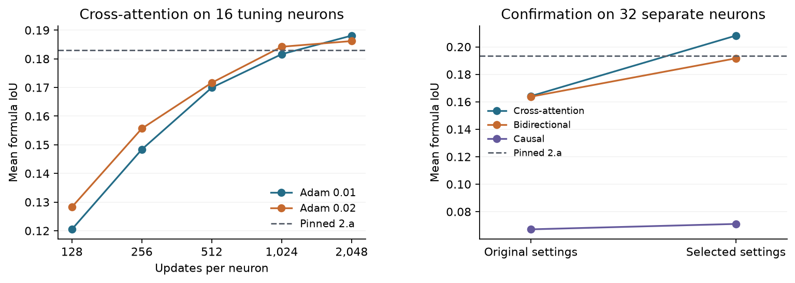

# Tuning neural formula search on the SNLI LLM

Cross-attention with encoder width **96**, readout width **32**, Adam learning rate **0.01** and **2,048 updates per neuron** reached mean IoU **0.2082** on the 32 confirmation neurons. It improved on the original 256-update search on all 32. Pinned vectorized 2.a averaged **0.1936**, and the tuned cross-attention formula won on 25 of the 32 neurons. The mean paired advantage over 2.a was 0.0146 IoU, with a 95% neuron-bootstrap interval from +0.0077 to +0.0215. These results cover the confirmation cohort.



## What was tuned

Each fit starts with a fresh transformer and Adam optimizer for a single `model.embedding_norm` neuron of the SNLI LLM at checkpoint 882. Its input contains that neuron's firing mask and all 3,854 named concept masks across all 10,000 examples. Both training and scoring use these same examples. Every score here comes from the formula decoded directly from the final trained model. Each update continues to use 24 sampled formulas and their terminal IoUs.

The architecture choices set the width of the query, key and value projections and the width of the readout MLP. The optimizer choices set Adam's learning rate and the number of updates per neuron. The reference neural configuration uses encoder width 96, readout width 32, Adam rate 0.01 and 256 updates. Each selected model's weights are still learned independently for every neuron.

1. **Screen on eight neurons.** At 256 updates, change one axis at a time. Test encoder widths 48, 96 and 192, readout widths 16, 32 and 64, and Adam rates 0.003, 0.01 and 0.02. Run all seven configurations for each of cross, bidirectional and causal attention.
2. **Select on 16 neurons.** For each mode, test the highest-scoring single adjustment, the combination of the best value on each axis, and the original settings at 128, 256 and 512 updates. Identical combinations share a trial. For cross-attention, the mean IoU kept increasing at 512, so the search also tested 1,024 and 2,048 updates at the two leading learning rates. Select the highest mean terminal IoU for each mode, with median warm time as a tiebreaker.
3. **Confirm on 32 separate neurons.** Freeze the selected settings before evaluating them on these neurons. Pair every result with a new fit at the original settings and with the archived pinned 2.a formula on the same target. An additional control uses the original model widths and learning rate with the winner's update count. This measures what the changes to width and learning rate add beyond training longer.

The eight screen IDs were 0, 2, 4, 127, 383, 639, 895 and 1279. The 16 selection IDs were the earlier width-pilot cohort and included the eight screen IDs. Confirmation used every other ID in the sorted, previously sampled 64-neuron cohort outside that pilot. The model seed was 20261111 throughout. The experiment measures reconstruction of the same examples on other neurons of this layer.

## Where the gains came from

| Confirmation on the same 32 neurons | Encoder / readout | Adam rate | Updates | Mean IoU, original → selected | Median selected terms | Median warm time |
| --- | ---: | ---: | ---: | ---: | ---: | ---: |
| Cross-attention | 96 / 32 | 0.01 | 2,048 | 0.1641 → **0.2082** | 163 | 50.39 s |
| Bidirectional self-attention | 96 / 16 | 0.01 | 512 | 0.1637 → **0.1916** | 130 | 42.57 s |
| Causal self-attention | 48 / 32 | 0.01 | 512 | 0.0671 → **0.0711** | 9 | 20.15 s |
| Pinned vectorized 2.a | — | — | — | 0.1936 | 48 | 7.84 s |

Training longer accounted for nearly all of the bidirectional gain. At 512 updates, the original 32-unit readout scored 0.1912. Narrowing it to 16 scored 0.1916, a difference of 0.0005 with paired interval [−0.0045, +0.0053]. For causal attention, narrowing the encoder from 96 to 48 at the same 512 updates raised IoU from 0.0680 to 0.0711, a difference of 0.0031 with paired interval [+0.0007, +0.0054]. These are 95% percentile intervals over 10,240 paired neuron resamples. All fits used the same model seed.

For a smaller compute budget, the cross-attention configuration selected at 512 updates used 96/32 widths and an Adam rate of 0.02. It achieved 0.1898 on the confirmation neurons with a median warm time of 12.35 s. At the same budget and the original Adam rate of 0.01 it scored 0.1887 in 11.91 s.

For cross-attention, the selected change was the number of training updates. The 16 tuning neurons also show why the choice of learning rate depended on that budget.

| Cross-attention, 96/32 | 128 updates | 256 | 512 | 1,024 | 2,048 |
| --- | ---: | ---: | ---: | ---: | ---: |
| Adam 0.01 | 0.1205 | 0.1484 | 0.1699 | 0.1816 | **0.1881** |
| Adam 0.02 | 0.1283 | 0.1557 | 0.1716 | 0.1842 | 0.1862 |

On the confirmation neurons, eight times as many updates raised cross-attention IoU by 0.0441 on average, with a 95% paired neuron-bootstrap interval from +0.0413 to +0.0471. The median formula grew from 97 to 163 terms. Its first 48 terms averaged 0.1170, compared with 0.1285 for the original neural model's first 48. This is a gain in the quality of the completed variable-length formula. Pinned 2.a used 48 terms.

## Reproduce a selected fit

```sh
uv run taskce formula-search --profile snli --stage search --inputs-dir inputs \
  --layer embedding_norm --ids 0 --all-examples --min-fit-fraction 0 \
  --backend neural_search --attention-mode cross --encoder-width 96 --readout-width 32 \
  --learning-rate 0.01 --max-iterations 2048 --chunk-size 1 --device cuda --output runs/tuned-cross
```

The [configuration CSV](tuning_configurations.csv) gives every measured configuration, cohort size, paired score difference, and warm timing. The [per-neuron CSV](tuning_neurons.csv.gz) gives the complete decoded formulas, intersections, unions, term counts, prefix-48 scores, and file checksums. All 920 fits across 57 stage/configuration combinations were independently replayed from the saved tables and attention edges against the original concept masks. The [tuning worker](benchmark_tuning.py) runs a configuration from a JSON list using `python -m formula_search.neural_search.benchmark_tuning inputs output reference.csv params.json --shard N`.

All fits ran one neuron at a time on Nautilus Kubernetes NVIDIA TITAN Xp cards, PyTorch 2.6.0 and CUDA 12.4. Timings synchronize CUDA and include model setup, transfers, training and final decoding. They exclude file I/O and independent replay. The tables report medians excluding the first fit on each worker. Separate runs can experience different cluster load. The vectorized 2.a timing comes from its earlier same-hardware run.

The frozen model and worker source are in [commit 1163d5f](https://github.com/aiea-lab/TaskCE/commit/1163d5f). The replay package on claim `gilpin-lab/ggong1-dev-main` is under `TaskCE/data/runs/neural-search/tuning-1163d5f`. It contains every shard's parameters, raw outputs, original inputs, Kubernetes completion records and verification scripts.
