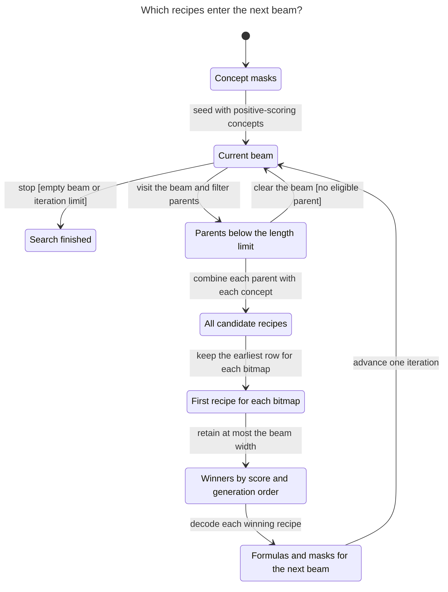

# Vectorized search



To profile the existing first-neuron search, run from the repository root:

```sh
python formula_search/profile_first_neuron.py --activation <activation.pt> --output-dir <profile-output> --profile
```

The CLI prepares the configured SNLI inputs, then profiles the complete `search_all` call on CUDA, including host-to-device conversion and the final CUDA synchronization. It writes the source hash and Git HEAD with `result.json`, plus HTML, JSON, text, and Speedscope profiles. Install the optional sampler with `uv pip install pyinstrument==5.1.3`; without `--profile`, Pyinstrument is not imported. This is a host wall-clock profile and does not break down individual GPU kernels.
