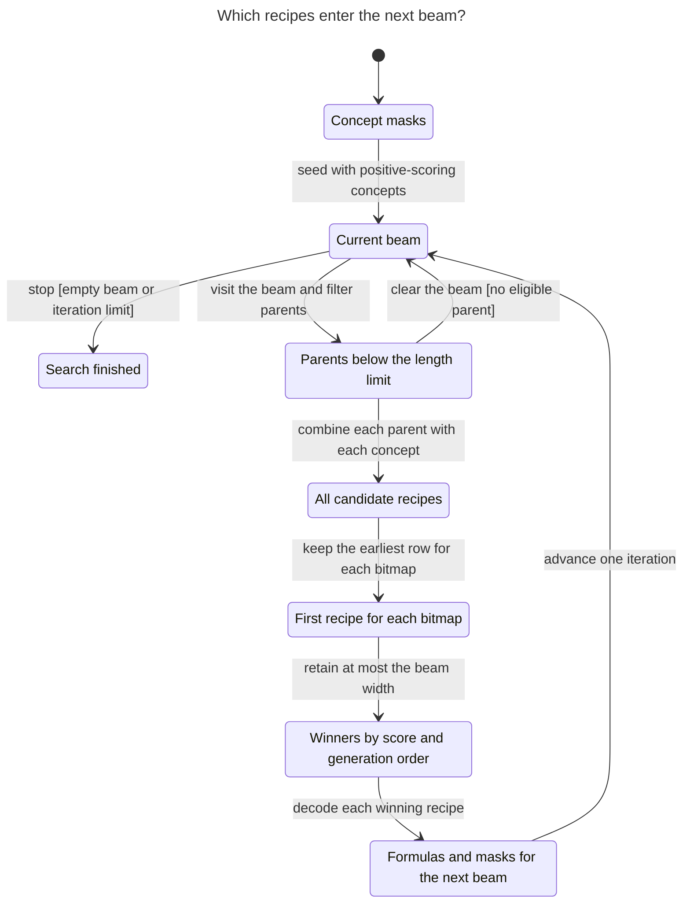

# Checking candidate selection

[TLC](https://github.com/tlaplus/tlaplus) checked all **3,648 reachable model states** in [BeamSearch.tla](BeamSearch.tla) under [BeamSearch.cfg](BeamSearch.cfg). Seven invariants held, no state deadlocked, and every fair execution reached the stop condition. The model describes one neuron. It does not run [algorithm.py](../algorithm.py).

| What must hold | Where to check the correspondence |
| --- | --- |
| A generated row means the same (eligible parent, concept, operation) for its mask and formula. | `LevelSearch` indexes parent formulas and vectors with the same ordered `parent_indices`. It stacks `OPERATIONS` on dimension 2 and flattens the first three dimensions. `Composition.from_row` decodes those dimensions in reverse. `FlattenCoordinates` compares the resulting bits to set intersection, union, or difference. |
| One bitmap has one representative: the first recipe that produced it. | `_first_rows_per_mask` reduces the generated row IDs by minimum for each unique mask. `FirstRepresentative` compares that row against **every** generation of the mask. |
| The next beam takes the highest scores; earlier generation wins ties, including at the cutoff. | `_select_candidates` orders the representatives by row ID, then uses a stable descending score sort. `StableScoreOrder` compares winners both with each other and with excluded masks. |
| Each winner gets the formula, parent, and bitmap of its selected row. | `LevelSearch` gathers `candidate_masks[selected_ids]` and decodes the same IDs against the eligible formulas. `AncestryMatchesFirstRow` checks the exact recipe even if two parents have identical masks. `AncestryUsesSourceBeam` and `FormulaVectorAgreement` compare formula meaning and bitmap after replacement. |
| The loop finishes by its iteration cap, including an empty initial beam and no eligible parents. | `LevelSearch` checks the beam and cap at entry, and increments once per visit. `IterationBound` and `EventuallyStops` check the bound and termination, assuming an enabled step eventually runs. |

The smaller [chart configuration](chart.cfg) fixes the width and cap at two. It uses both input orders of two disjoint one-bit concepts. It reached 192 states and 216 transitions. The chart groups them into eight states and nine arrows; it omits 20 transitions within the same label.



## Bounds

The full check starts from 384 input configurations: all four two-bit neuron masks, all 16 ordered pairs of two-bit concept masks (including duplicates), widths 1 and 2, and caps 0, 1, and 2. Scores use exact intersection and union sizes. With two samples all possible scores are exactly representable in float32.

All initial formulas are atoms of equal length. Later, the model can choose **any** ordered subset of the beam as eligible, so it covers gaps in parent indices but also visits paths that no fixed SymPy length limit would produce. It checks the meaning and immediate ancestry of formulas, not their simplification, printed form, or the best formula accumulated across iterations. It assumes tensor and sort semantics; it does not verify packing, padding, the Triton kernel, device execution, memory use, or speed.

## What would fail

These are faults deliberately injected into the **model**, not findings against the Python code. Step numbers count transitions from the initial state (step 0).

| `Mutation` | First failing step on a shortest path | Source behavior that prevents it |
| --- | --- | --- |
| `last` | 4, deduplication: A AND A and A OR A share a bitmap; the second recipe replaces the first. | `scatter_reduce_(..., reduce="amin")` keeps the earlier row. |
| `tie` | 5, selection: in the [worked example](../README.md), bitmap `01` takes the second slot ahead of `10`. | `_select_candidates` orders by first generation before sorting scores. |
| `remap` | 12, rebuilding the second beam: decoding an eligible-parent position against the full beam can select an ineligible parent. Exact ancestry, source-mask agreement, and formula-mask agreement each fail on a shortest path of this length. | `Composition.from_row` receives the filtered `parent_formulas`, in the same order used to generate masks. |

The worked example also shows why checking only the bits is insufficient. With a length limit of two, the beam after one expansion is [A OR B, A]. Only A can expand. Eligible-parent position 0 names A, while position 0 in the original beam names A OR B. Combining the wrong parent with B by OR still gives `11`. The ancestry check distinguishes the two recipes. Python numbers rows from zero; the TLA+ sequences start at one.

## Reproduce

Run from this directory with Java and [TLA+ tools v1.7.4](https://github.com/tlaplus/tlaplus/releases/tag/v1.7.4). No Python environment, dataset, or GPU is needed:

```sh
java -cp /path/to/tla2tools.jar tlc2.TLC -workers 1 -config BeamSearch.cfg BeamSearch.tla
```

To regenerate the chart and per-rule reports with the Statechart skill, run in PowerShell with Node 24 and Java 11 or newer. Each output directory must be new or empty:

```powershell
$skill = "$HOME/.codex/skills/statechart"
node "$skill/scripts/tlc.ts" install
$out = Join-Path ([IO.Path]::GetTempPath()) ("beam-check-" + [guid]::NewGuid())
node "$skill/scripts/statechart.ts" BeamSearch.tla --config BeamSearch.cfg --view view.mjs --out "$out-full"
node "$skill/scripts/statechart.ts" BeamSearch.tla --config chart.cfg --view view.mjs --out "$out-chart"

foreach ($fault in 'last', 'tie', 'remap') {
    $cfg = "$out-$fault.cfg"
    (Get-Content -Raw chart.cfg).Replace('Mutation="none"', ('Mutation="' + $fault + '"')) | Set-Content -Encoding ascii $cfg
    node "$skill/scripts/statechart.ts" BeamSearch.tla --config $cfg --view view.mjs --out "$out-$fault"
}
```

Both unmodified runs exit 0. Each fault run exits 1 and writes its counterexample to `report.md` and the TLC trace to `tlc.out`.
